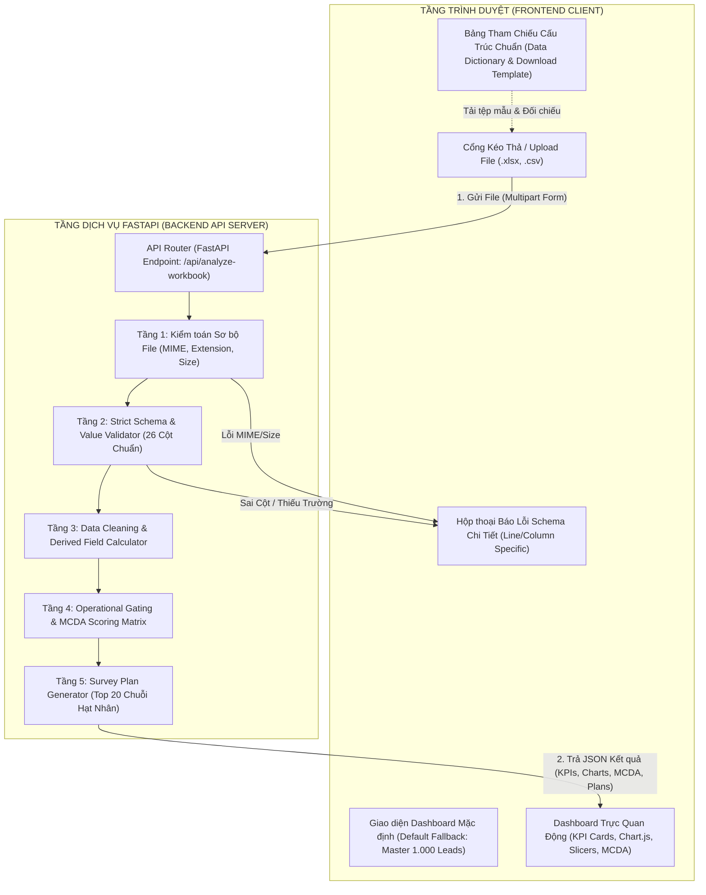

# ĐẶC TẢ KIẾN TRÚC WORKFLOW XUYÊN SUỐT & QUY TẮC VẬN HÀNH NỀN TẢNG
## HỆ THỐNG WEB BÓC TÁCH, THẨM ĐỊNH & PHÂN TÍCH ĐÁNH GIÁ THỊ TRƯỜNG (AI301 - ĐỀ 04)

> **Mục tiêu của tài liệu:** Thiết lập một quy trình vận hành chuẩn mực, khép kín, định nghĩa rõ ràng trách nhiệm của từng tầng module, thiết lập các chốt chặn kiểm soát chất lượng dữ liệu nghiêm ngặt, loại bỏ hoàn toàn tình trạng xung đột tài nguyên ("giẫm chân nhau") và chuẩn bị sẵn sàng các kịch bản ứng phó rủi ro kỹ thuật khi vận hành thực tế.

---

## I. TỔNG QUAN KIẾN TRÚC & TRIẾT LÝ VẬN HÀNH

Hệ thống được thiết kế theo mô hình **Stateless Client-Server Architecture (Kiến trúc phi trạng thái)** kết hợp **Data Contract Pattern (Quy ước dữ liệu nghiêm ngặt)**.

---

## II. QUY TRÌNH 5 BƯỚC XUYÊN SUỐT (END-TO-END WORKFLOW)

Quy trình xử lý một lượt dữ liệu từ lúc người dùng tương tác đến khi hiển thị kết quả được cố định qua 5 bước tuần tự:

### Bước 1: Tiếp nhận & Kiểm tra Sơ bộ (Ingestion & Sanity Checking)
1. **Tiếp nhận:** Người dùng kéo thả hoặc bấm chọn tệp dữ liệu (`.xlsx` hoặc `.csv`) tại giao diện Upload.
2. **Kiểm tra sơ bộ:**
   * Tệp phải có phần mở rộng hợp lệ: `.xlsx` hoặc `.csv`.
   * Giới hạn dung lượng: $\le 20 \text{ MB}$ (ngăn chặn tình trạng tràn bộ nhớ / treo server).
   * Kiểm tra tính nguyên vẹn: Trích xuất mã băm SHA-256 của file tải lên để lập hồ sơ kiểm toán.

### Bước 2: Thẩm định Hợp đồng Dữ liệu (Strict Schema Validation Gate)
> [!IMPORTANT]
> Đây là chốt chặn quan trọng nhất của hệ thống nhằm ngăn chặn triệt để nguyên lý "Rác vào - Rác ra" (Garbage In - Garbage Out).

* **Khám nghiệm tiêu đề cột (Header Auditing):** So khớp chính xác 26 tiêu đề cột với Master Data Contract. Nếu thiếu dù chỉ 01 cột nghiệp vụ cốt lõi (ví dụ: thiếu cột `Khoảng Cách Đến Trạm Kỹ Thuật (km)`), hệ thống lập tức ngắt luồng và trả về mã lỗi `422 Unprocessable Entity`.
* **Kiểm tra miền giá trị hợp lệ (Domain & Type Constraints):**
  * `Mã Địa Bàn`: Bắt buộc chỉ thuộc tập hợp giá trị `['DB-01', 'DB-02', 'DB-03', 'DB-04']`.
  * Các trường tiền tệ, khoảng cách, số lượng: Phải là số dương ($\ge 0$).
  * `Yêu Cầu SLA Kỹ Thuật`: Phải chứa chuỗi thời gian chuẩn hóa (`<= 2h`, `<= 4h`, `<= 24h`...).
* **Phản hồi lỗi (Error Response):** Không báo lỗi chung chung. Phải trả về danh sách tọa độ lỗi cụ thể: `[Dòng X, Cột Y: Giá trị Z không hợp lệ]`.

### Bước 3: Làm sạch & Tính toán Dẫn xuất (Data Cleansing & Transformation)
* Khử bỏ khoảng trắng thừa hai đầu (`trim`), chuẩn hóa định dạng ngày tháng `d/m/yyyy` và chuỗi thời gian `mm/yyyy`.
* Tự động tính toán các trường tài chính nếu thiếu:
  $$\text{Doanh thu thuần} = \text{Doanh thu gộp} - \text{Giá chiết khấu}$$
  $$\text{Lợi nhuận gộp} = \text{Doanh thu thuần} - \text{Giá vốn hàng bán}$$
  $$\text{Biên lợi nhuận gộp} = \frac{\text{Lợi nhuận gộp}}{\text{Doanh thu thuần}} \times 100\%$$

### Bước 4: Thực thi Luật Nghiệp vụ, Lọc Gating & Chấm Điểm MCDA
* **Operational Gating Filter (Bộ lọc điều kiện tiên quyết):**
  * *Ngưỡng SLA:* Khách hàng có cự ly $> 500 \text{ km}$ nhưng yêu cầu SLA on-site $\le 2\text{h}$ $\rightarrow$ Đánh dấu vi phạm, gán nhãn `LOẠI BỎ (Vi phạm SLA)`.
  * *Ngưỡng Sản phẩm:* Khách hàng không tương thích WMS (mô hình hộ cá thể, thu mua thô) $\rightarrow$ Gán nhãn `LOẠI BỎ (Sai lệch phân khúc)`.
* **Ma trận chấm điểm đa tiêu chí (MCDA Scoring):**
  $$\text{Tổng điểm MCDA} = (S_{\text{Fit}} \times 0.35) + (S_{\text{Deploy}} \times 0.30) + (S_{\text{Comp}} \times 0.20) + (S_{\text{Scale}} \times 0.15)$$
* **Xếp hạng:** Xác định Top 1 (`DB-01`) và Top 2 (`DB-02`).

### Bước 5: Trực quan Hóa & Bàn giao Thực địa (Visualization & Export)
* Đóng gói payload JSON trả về cho Frontend gồm:
  * 5 KPI Cards động (Tổng leads, Tỷ lệ đạt gating, Ngân sách khả dụng, Top 1, Top 2).
  * Dữ liệu biểu đồ Chart.js (Cơ cấu giải pháp WMS, Doanh thu/Ngân sách theo địa bàn).
  * Bảng Ma trận MCDA 4 địa bàn.
  * Bảng Kế hoạch khảo sát thực địa 20 chuỗi hạt nhân.
* Cung cấp nút bấm cho phép người dùng **"Tải lại Báo cáo Thẩm định Excel / CSV"**.

---

## III. MA TRẬN 26 CỘT QUY CHUẨN DỮ LIỆU BẮT BUỘC (DATA CONTRACT)

Bảng tham chiếu này được nhúng trực tiếp vào Backend và hiển thị tại Modal tra cứu trên Web:

| STT | Tên Cột Bắt Buộc | Kiểu Dữ Liệu | Bắt Buộc | Miền Giá Trị Hợp Lệ & Ý Nghĩa Nghiệp Vụ |
|:---:|---|---|:---:|---|
| 1 | `Mã Hồ Sơ` | Chuỗi | **CÓ** | Khóa định danh duy nhất (VD: `REC-0001` đến `REC-1000`). |
| 2 | `Mã Địa Bàn` | Enum | **CÓ** | Chỉ nhận 1 trong 4 mã: `DB-01`, `DB-02`, `DB-03`, `DB-04`. |
| 3 | `Tên Địa Bàn` | Chuỗi | **CÓ** | Tên chuẩn hóa của 4 vùng khảo sát. |
| 4 | `Tỉnh/Thành Phố` | Chuỗi | **CÓ** | Tên Tỉnh/Thành phố có dấu tiếng Việt chuẩn. |
| 5 | `Tên Doanh Nghiệp Khảo Sát` | Chuỗi | **CÓ** | Tên doanh nghiệp/chuỗi bán lẻ. |
| 6 | `Mô Hình Bán Lẻ` | Chuỗi | **CÓ** | 16 mô hình bán lẻ (Điện máy, Thực phẩm, Dược phẩm...). |
| 7 | `Số Cửa Hàng` | Số nguyên | **CÓ** | Số điểm bán thuộc chuỗi ($\ge 1$). |
| 8 | `Số Kho Vận Hành` | Số nguyên | **CÓ** | Số lượng kho trung tâm/vệ tinh ($\ge 0$). |
| 9 | `Doanh Thu Năm (VNĐ)` | Tiền tệ | **CÓ** | Doanh thu quy mô năm ($\ge 0$). |
| 10 | `Giải Pháp Lựa Chọn` | Chuỗi | **CÓ** | Nhu cầu phân hệ WMS/Barcode/RFID/Date. |
| 11 | `Độ Tương Thích Sản Phẩm` | Enum | **CÓ** | `Khớp hoàn toàn`, `Khớp một phần`, `Lệch sản phẩm (Mismatch)`. |
| 12 | `Ngân Sách Dự Kiến Đầu Tư (VND)`| Tiền tệ | **CÓ** | Ngân sách doanh nghiệp sẵn sàng chi trả ($\ge 0$). |
| 13 | `Yêu Cầu SLA Kỹ Thuật` | Chuỗi | **CÓ** | Cam kết thời gian hỗ trợ on-site (`<= 2h`, `<= 4h`...). |
| 14 | `Khoảng Cách Đến Trạm Kỹ Thuật (km)`| Số thập phân | **CÓ** | Cự ly thực tế tính bằng km đến trạm kỹ thuật gần nhất. |
| 15 | `Khả Năng Đáp Ứng của Hưng Phát`| Enum | **CÓ** | `Khả thi (SLA phù hợp)`, `Không khả thi`, `Vượt quá năng lực`. |
| 16 | `Kỳ Thống Kê` | Chuỗi | **CÓ** | Thời gian ghi nhận dữ liệu (Kiểm tra dữ liệu cũ/lỗi thời). |
| 17 | `Nguồn Tài Liệu Dữ Liệu` | Chuỗi | **CÓ** | Tên báo cáo nguồn (AVR, Sở Công Thương, Niên giám...). |
| 18 | `Trùng Lặp Nguồn` | Enum | **CÓ** | `KHÔNG LẶP` hoặc `CÓ LẶP NGUỒN`. |
| 19 | `Ngày Khảo Sát` | Ngày | **CÓ** | Định dạng chuẩn `d/m/yyyy`. |
| 20 | `Phân Khúc Khách Hàng ` | Enum | **CÓ** | `Doanh nghiệp lớn`, `Chuỗi bán lẻ vừa`, `Khách hàng cá nhân`. |
| 21 | `Kênh Tiếp Cận` | Chuỗi | **CÓ** | Kênh thu thập thông tin (Khảo sát thực địa, Hội chợ, Online). |
| 22 | `Mức Độ Sẵn Sàng Số (1-5)` | Số nguyên | **CÓ** | Thang điểm từ 1 đến 5 đánh giá hạ tầng số. |
| 23 | `Người Đại Diện / Chức Danh` | Chuỗi | **CÓ** | Họ tên & chức danh người phụ trách doanh nghiệp. |
| 24 | `Số Điện Thoại / Email` | Chuỗi | **CÓ** | Thông tin liên hệ kiểm toán. |
| 25 | `Ghi Chú Đánh Giá / Rủi Ro Vận Hành`| Chuỗi | Không | Cảnh báo vi phạm SLA hoặc rủi ro kỹ thuật. |
| 26 | `Kết Luận Đánh Giá` | Enum | **CÓ** | `Đạt tiêu chuẩn thẩm định`, `LOẠI BỎ (Vi phạm SLA)`, `LOẠI BỎ (Sai phân khúc)`. |

---

## IV. BỘ QUY TẮC VẬN HÀNH CỐ ĐỊNH (OPERATING GOVERNANCE)

Để tránh tình trạng xung đột tài nguyên, ghi đè dữ liệu hoặc sập dịch vụ khi nhiều thao tác diễn ra cùng lúc, hệ thống tuân thủ **5 quy tắc bất biến**:

### Quy tắc 1: Xử lý Phi trạng thái Tuyệt đối (Stateless Request Processing)
* Backend không lưu trạng thái phiên (session) trong bộ nhớ server.
* Mỗi request tải file lên được xử lý độc lập hoàn toàn trong RAM (hoặc thư mục tạm dạng `tempfile` tự hủy).
* Điều này đảm bảo: Hai người dùng upload cùng lúc không bao giờ bị ghi đè dữ liệu của nhau, không gây ra hiện tượng race condition.

### Quy tắc 2: Chính sách Không Khoan nhượng với Dữ liệu Lỗi (Zero Tolerance Gate)
* Nếu tệp tải lên vi phạm schema (thiếu cột hoặc sai miền giá trị bắt buộc), backend **tuyệt đối không tự ý bịa đặt hoặc đoán mò giá trị thiếu**.
* Hệ thống bắt buộc phải từ chối ngay lập tức (`HTTP 422`), chỉ rõ lỗi và hướng dẫn người dùng sửa đổi.

### Quy tắc 3: Nguyên tắc Dự phòng Mặc định (Default Master Fallback)
* Khi khởi động ứng dụng web, hệ thống luôn tự động tải tập dữ liệu Master [`AI301_De04_Master_1000_Leads.xlsx`](file:///D:/antigravity/Bai-tap-giua-ki/AI301_De04_Master_1000_Leads.xlsx) làm dữ liệu gốc.
* Nếu người dùng upload file lỗi hoặc hủy bỏ, giao diện tự động quay về trạng thái chuẩn mực mặc định, không bao giờ để màn hình trắng (blank screen).

### Quy tắc 4: Bất biến Dữ liệu Gốc (Immutability of Source Files)
* Tệp tải lên chỉ được đọc (`read-only`) để bóc tách thông tin.
* Pipeline xử lý không bao giờ chỉnh sửa trực tiếp vào file của người dùng, đảm bảo tính toàn vẹn kiểm toán.

### Quy tắc 5: Định danh & Dấu vết Kiểm toán (Audit Traceability)
* Mọi lượt phân tích đều tự động tính toán mã băm SHA-256 của tập dữ liệu và đính kèm vào kết quả JSON, đảm bảo khả năng tái lập (reproducibility) 100% trong tương lai.

---

## V. MA TRẬN QUẢN TRỊ RỦI RO & PHƯƠNG ÁN XỬ LÝ (RISK MANAGEMENT)

| Mã Rủi Ro | Tình Huống Kỹ Thuật / Nghiệp Vụ | Mức Độ | Phương Án Ứng Phó Cụ Thể (Mitigation Strategy) |
|:---:|---|:---:|---|
| **RSK-01** | **Tệp tải lên sai tên cột hoặc thiếu cột bắt buộc** | **Cao** | **Schema Interceptor:** Kiểm tra danh sách cột trước khi đọc dữ liệu. Nếu thiếu, trả về JSON `{ "status": "error", "code": "MISSING_COLUMNS", "missing": [...] }`. Frontend hiển thị Modal đỏ chỉ rõ cột thiếu và nút tải tệp mẫu. |
| **RSK-02** | **Tệp có nhiều sheet hoặc tên sheet bị đổi** | **Trung bình** | **Smart Sheet Discovery:** Ưu tiên đọc sheet có tên chứa chữ `"Dữ liệu nguồn"` (không phân biệt hoa thường và khoảng trắng). Nếu không có, tự động đọc sheet đầu tiên (`wb.worksheets[0]`). |
| **RSK-03** | **Tệp chứa dòng trống (`null`), dòng ghi chú ở đầu/cuối** | **Trung bình** | **Header Auto-Trimmer:** Tự động quét tìm dòng chứa đủ các tiêu đề cốt lõi để làm Header (thay vì cố định dòng 1), và loại bỏ tất cả các dòng có `Mã Hồ Sơ` bị rỗng. |
| **RSK-04** | **Xung đột cổng mạng (Port 8000 đã bị ứng dụng khác chiếm)** | **Thấp** | **Dynamic Port Fallback:** Script khởi động kiểm tra cổng 8000. Nếu bận, tự động nhảy sang cổng 8001 hoặc 8080 và in thông báo rõ ràng cho người dùng. |
| **RSK-05** | **Lỗi font chữ tiếng Việt (Encoding / Mojibake)** | **Thấp** | **UTF-8 Enforcement:** Ép chuẩn mã hóa `utf-8-sig` khi đọc CSV và sử dụng thư viện `openpyxl` nguyên bản để đọc trực tiếp định dạng nhị phân của Excel `.xlsx`. |

---

## VI. BỘ TIÊU CHÍ NGHIỆM THU NỀN TẢNG (ACCEPTANCE CRITERIA)

Hệ thống chỉ được coi là hoàn tất khi vượt qua trọn vẹn 4 ca kiểm chuẩn:
1. **Ca 1 (Happy Path - Dữ liệu chuẩn):** Upload file `AI301_De04_Master_1000_Leads.xlsx` $\rightarrow$ Web hiển thị Dashboard trong $\le 1.5$ giây; điểm MCDA DB-01 là 4.70, DB-02 là 4.28; DB-03 và DB-04 bị loại bỏ chính xác.
2. **Ca 2 (Error Handling - Thiếu cột):** Upload file đã xóa cột `Khoảng Cách Đến Trạm Kỹ Thuật (km)` $\rightarrow$ Web từ chối ngay, bật hộp thoại đỏ thông báo đúng tên cột thiếu, không bị treo trình duyệt.
3. **Ca 3 (Reference Table):** Bấm nút "Bảng Tham Chiếu" $\rightarrow$ Hiển thị đầy đủ 26 cột kèm nút "Tải File Mẫu".
4. **Ca 4 (Export Report):** Bấm nút "Xuất Kết Quả Phân Tích" $\rightarrow$ Tải về tệp CSV/JSON sạch chứa kết quả chấm điểm của Agent.
