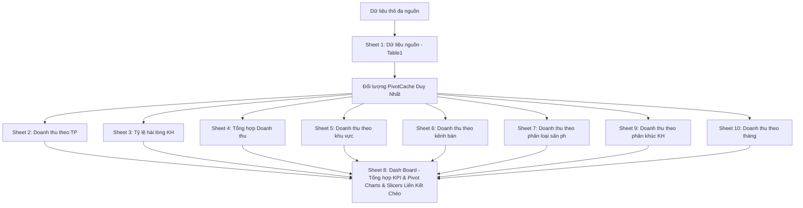

# ĐẶC TẢ QUY CHUẨN XỬ LÝ DỮ LIỆU & KIẾN TRÚC BI TIÊU CHUẨN

Tài liệu này xác lập quy chuẩn kiến trúc phân tích kinh doanh (Business Intelligence) và mô hình dữ liệu chuẩn áp dụng cho mọi bài toán phân tích.

---

## I. KIẾN TRÚC 10 SHEETS BẮT BUỘC SỬ DỤNG NATIVE PIVOT TABLE

### Danh Mục 10 Sheet Tiêu Chuẩn:
1. **`Dữ liệu nguồn `**: Lưu trữ toàn bộ bảng giao dịch sạch được đóng gói trong **Excel Table (`Table1`)**.
2. **`Doanh thu theo TP`**: Pivot Table + Pivot Chart phân tích Doanh thu thuần & Lợi nhuận gộp theo từng Tỉnh/Thành phố.
3. **`Tỷ lệ hài lòng KH`**: Pivot Table + Pivot Chart đo lường Mức độ hài lòng TB theo danh mục sản phẩm (format `0.0000`).
4. **`Tổng hợp Doanh thu `**: Pivot Table tóm lược KPI hệ thống: Doanh thu thuần, Lợi nhuận gộp, Số đơn hàng, Số dòng sản phẩm, Thời gian giao hàng trung bình, và Số lượng khách hàng duy nhất (`=COUNTA(UNIQUE(...))`).
5. **`Doanh thu theo khu vực `**: Pivot Table + Pivot Chart phân bổ theo các Vùng miền.
6. **`Doanh thu theo kênh bán `**: Pivot Table + Pivot Chart phân bổ theo Kênh bán hàng / Phân phối.
7. **`Doanh thu theo phân loại sản ph`**: Pivot Table + Pivot Chart phân bổ theo Nhóm ngành hàng / Dòng sản phẩm.
8. **`Dash Board`**: Bảng điều khiển quản trị trực quan với Thẻ KPI Cards, 7 Biểu đồ phân tích và Hệ thống Slicers tương tác liên kết chéo.
9. **`Doanh thu theo phân khúc KH `**: Pivot Table + Pivot Chart phân bổ theo Phân khúc khách hàng / Đối tượng mục tiêu.
10. **`Doanh thu theo tháng`**: Pivot Table + Pivot Chart phân tích chuỗi thời gian theo Tháng (`mm/yyyy`).

---

## II. MA TRẬN 25 CỘT DỮ LIỆU GIAO DỊCH CHUẨN HÓA (`Table1`)

| STT | Tên Cột | Kiểu Dữ Liệu | Number Format | Quy Tắc Chuẩn Hóa & Công Thức |
|:---:|:---|:---|:---|:---|
| 1 | `Mã order` | Chuỗi | `General` | Mã định danh chuẩn: tiền tố viết hoa, không khoảng trắng thừa. |
| 2 | `Ngày ord` | Ngày | `[$-1010000]d/m/yyyy;@` | Định dạng chuẩn ngày/tháng/năm: `d/m/yyyy`. |
| 3 | `Tháng ` | Chuỗi tính toán | `[$-1010000]d/m/yyyy;@` | `=TEXT(B:B, "mm/yyyy")` hoặc `=TEXT([@[Ngày ord]], "mm/yyyy")`. |
| 4 | `Mã KH` | Chuỗi | `General` | Mã định danh khách hàng chuẩn hóa. |
| 5 | `Vùng miền ` | Phân loại | `General` | Đồng bộ các miền chuẩn hóa. |
| 6 | `Thành phố` | Phân loại | `General` | Viết hoa, có dấu tiếng Việt chuẩn. |
| 7 | `Phân khúc khách hàng ` | Phân loại | `General` | Phân khúc đối tượng chuẩn (Cá nhân, VIP, Doanh nghiệp). |
| 8 | `Kênh bán hàng ` | Phân loại | `General` | Kênh phân phối chuẩn (In-Store, Online Web/App, TMĐT). |
| 9 | `Danh mục nhóm sản phẩm ` | Phân loại | `General` | Phân loại ngành hàng chính. |
| 10 | `Danh mục nhóm sản phẩm con ` | Phân loại | `General` | Nhóm sản phẩm chi tiết theo ngành hàng. |
| 11 | `Mã SP` | Chuỗi | `General` | Mã SKU sản phẩm chuẩn hóa. |
| 12 | `Tên sản phẩm ` | Chuỗi | `General` | Tên sản phẩm rõ ràng, kèm quy cách. |
| 13 | `Số lượng ` | Số nguyên | `General` | Số lượng mua >= 1. |
| 14 | `Giá niêm yết ` | Tiền tệ | `_-* #,##0\ [$₫-42A]_-;...` | Đơn giá chuẩn VND có ký hiệu ₫. |
| 15 | `Chiết khấu ` | Tỷ lệ % | `0%` | Tỷ lệ chiết khấu (0%, 5%, 10%, 15%...). |
| 16 | `Doanh thu gộp ` | Tiền tệ | `_-* #,##0\ [$₫-42A]_-;...` | `= [Số lượng] * [Giá niêm yết]` |
| 17 | `Giá chiết khấu ` | Tiền tệ | `_-* #,##0\ [$₫-42A]_-;...` | `= [Doanh thu gộp] * [Chiết khấu]` |
| 18 | `Doanh thu  thuần ` | Tiền tệ | `_-* #,##0\ [$₫-42A]_-;...` | `= [Doanh thu gộp] - [Giá chiết khấu]` |
| 19 | `Giá vốn hàng bán ` | Tiền tệ | `_-* #,##0\ [$₫-42A]_-;...` | Giá vốn COGS chuẩn VND. |
| 20 | `Lợi nhuận gộp` | Tiền tệ | `_-* #,##0\ [$₫-42A]_-;...` | `= [Doanh thu  thuần ] - [Giá vốn hàng bán ]` |
| 21 | `Biên lợi nhuận gộp ` | Tỷ lệ % | `0.00%` | `=(Table1[[#This Row],[Lợi nhuận gộp]]/Table1[[#This Row],[Doanh thu  thuần ]])*100%` |
| 22 | `Tgian ship(Day)` | Số nguyên | `General` | Số ngày giao hàng (0, 1, 2, 3...). |
| 23 | `Hoàn trả` | Phân loại | `General` | Chuẩn hóa: `Không` hoặc `Có` (không để trống, không viết 0/1). |
| 24 | `Mức độ hài lòng ` | Điểm số | `General` | Thang điểm từ 1 đến 5. |
| 25 | `Phương thức thanh toán ` | Phân loại | `General` | Phân loại phương thức thanh toán chuẩn hóa. |